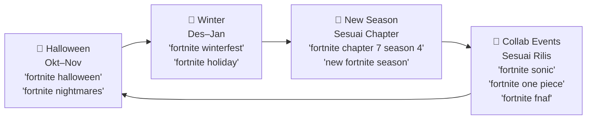

# 🎯 SEO & ASO Keyword Strategy
## Creative Island Hub — Android App
**Package**: `com.henrisusanto.creativeislandhub`
**Kategori**: Gaming Utility / Fortnite Creative & UEFN Island Code Discovery

> [!IMPORTANT]
> Keyword dikompilasi dari **3 sumber**: Google Keyword Planner (volume pencarian), ASO Autocomplete (kompetisi Play Store), dan Google Trends (tren & momentum). Semua diarahkan sesuai platform & field spesifik untuk Android app ini.

---

## 📊 Metodologi Skoring

Setiap keyword diberi **skor prioritas** berdasarkan kombinasi:
- 🔵 **Volume** — dari KW Planner (`1M+` = 10, `100K–1M` = 8, `10K–100K` = 6)
- 🟢 **Tren** — Search Interest dari Google Trends (100 = paling tinggi)
- 🟡 **Kompetisi ASO** — `hasil_relevan` rendah = peluang ASO lebih baik (sedikit app relevan = celah)
- 🔴 **Relevansi Proyek** — Seberapa dekat dengan fitur inti app (island codes, Creative, UEFN, tracker)

---

## 🏆 TIER 1 — Keyword Utama (Prioritas Sangat Tinggi)

*Wajib ada di semua touchpoint: title, short description, full description, metadata.*

| # | Keyword | Volume (Planner) | Trend Score | Relevansi | Rekomendasi Utama |
|---|---------|-------------------|-------------|-----------|-------------------|
| 1 | **fortnite** | 1M–10M | — | 🔥 Core brand | App title + semua deskripsi |
| 2 | **fortnite creative** | — | — | 🔥 Fitur inti | Play Store title + subtitle |
| 3 | **fortnite island codes** | — | — | 🔥 Fitur inti | Play Store short desc |
| 4 | **fortnite uefn** | — | ASO: 6 relevan | 🔥 Fitur inti | Full description + tags |
| 5 | **fortnite shop** | 10K–100K | 100 🔝 | ✅ Tinggi | Full description |
| 6 | **fortnite skins** | 10K–100K | 41 | ✅ Tinggi | Full description |
| 7 | **fortnite tracker** | 10K–100K | 71 | ✅ Tinggi | App subtitle + description |
| 8 | **fortnite item shop** | 10K–100K | 62 | ✅ Tinggi | Full description |
| 9 | **fortnite v bucks** | 100K–1M | — | ✅ Relevan (monetization) | Full description |
| 10 | **fortnite game** | 10K–100K | 35 | ✅ Core | App tags + description |

---

## 🥈 TIER 2 — Keyword Strategis (Prioritas Tinggi)

*Gunakan di Play Store Long Description, About section, & in-app strings.*

### 2A — Trending dengan Momentum Naik 📈

| # | Keyword | Trend Score | % Naik | Catatan ASO |
|---|---------|-------------|--------|-------------|
| 1 | **fortnite fnaf** | 10 | +10.5% 🚀 | Viral — kolaborasi FNaF × Fortnite |
| 2 | **fortnite one piece** | 11 | +5.5% 🚀 | Kolaborasi aktif |
| 3 | **fortnite sonic** | 12 | +5.0% 🚀 | Kolaborasi aktif |
| 4 | **fortnite chapter 7 season 4** | 12 | +4.5% 🚀 | Season aktif saat ini |
| 5 | **sonic fortnite** | 11 | +4.5% 🚀 | Alias query kolaborasi |
| 6 | **fortnite new season** / **new fortnite season** | 20 | +0.6% | Update konten reguler |
| 7 | **fortnite codes** | 54 | +3.0% | Langsung relevan — island codes |
| 8 | **fortnite gg** / **gg fortnite** | 27–28 | +0.1–0.2% | Community term |
| 9 | **fortnite code** | 36 | +0.1% | Alias untuk island codes |
| 10 | **fortnite battle pass** | 16 | +0.03% | Evergreen |

### 2B — Volume Tinggi + ASO Opportunity

| # | Keyword | Volume Planner | ASO (hasil relevan) | Peluang |
|---|---------|----------------|---------------------|---------|
| 1 | **fortnite battle royale** | — | 8 (terbatas) | Celah moderat |
| 2 | **fortnite mobile** | 10K–100K | 4 | Celah bagus |
| 3 | **fortnite download** | — | 1 | Volume tinggi, kompetisi rendah |
| 4 | **fortnite app** | — | 1 | Direct intent |
| 5 | **fortnite android** | — | 2 | Platform keyword |
| 6 | **fortnite epic games** | 10K–100K | 7 | Brand authority |
| 7 | **fortnite zero build** | — | 1 | Mode populer |
| 8 | **fortnite chapter 7** | — | 3 | Season aktif |
| 9 | **fortnite locker** | — | 4 | ASO: FN Spot muncul |
| 10 | **fortnite account** | — | 4 | Relevan ke unlock mechanic |

---

## 🥉 TIER 3 — Keyword Pendukung (Long-tail & Niche)

*Gunakan di full description paragraf tengah, FAQ, in-app UI labels, & GitHub content tags.*

### 3A — Island Code & Creative Specific

| Keyword | Relevansi | Penggunaan |
|---------|-----------|------------|
| fortnite creative codes | 🔥 Fitur inti | App description, in-app search hints |
| fortnite island code | 🔥 Fitur inti | App title consideration |
| uefn codes | 🔥 Fitur inti | Full description |
| fortnite creative map | ✅ Tinggi | Full description |
| fortnite creative mode | ✅ Tinggi | Description + tags |
| fortnite map codes | ✅ Tinggi | App tags |
| fortnite map | 25 trend | Full description |
| fortnite pvp codes | ✅ | Category chip labels |
| fortnite boxfight | ✅ | In-app category tags |
| fortnite zero build codes | ✅ | Category/tag labels |

### 3B — Tracker & Companion App Keywords

| Keyword | ASO hasil relevan | Kompetitor Utama | Penggunaan |
|---------|-------------------|------------------|------------|
| fortnite tracker | 7 | Tracker Network Stats | App subtitle |
| fortnite tracker app | 13 | Tracker Network, FN Spot | Full description |
| fortnite item shop tracker | 3 | Shop Of The Day | Full description |
| fortnite quest tracker | 6 | Companion for Fortnite | Full description |
| fortnite sprite tracker | 12 | Sprites Catalog | ⚠️ Hati-hati — saturasi tinggi |
| fortnite companion | — | Companion for Fortnite | Full description differentiator |
| fortnite helper | 2 | Companion for Fortnite | Full description |

### 3C — Kolaborasi & Event Keywords

| Keyword | Trend | Timing |
|---------|-------|--------|
| fortnite x naruto | 3 relevan | Update deskripsi saat event |
| fortnite x anime | 11 relevan | Evergreen untuk kategori |
| fortnite lego | 24 trend | Evergreen |
| fortnite festival | 3 relevan | Seasonal |
| fortnite halloween | 3 relevan | Seasonal (Oktober) |
| fortnite jjk | 4 relevan | Trending anime collab |
| fortnite battle pass | 16 trend | Evergreen |

### 3D — Skin & Item Keywords

| Keyword | Trend | Penggunaan |
|---------|-------|------------|
| skin fortnite / fortnite skin | 84–90 🔝 | Full description |
| fortnite skins | 41 | Description |
| fortnite emotes | 4 relevan | Full description |
| fortnite dance | 6 relevan | Full description |
| fortnite wallpaper | 10 relevan | Full description (awareness) |
| fishstick fortnite | 10K–100K | Long-tail description |
| meowscles | 10K–100K | Long-tail description |

---

## ❌ TIER 4 — Keyword Dikecualikan

*Jangan gunakan — tidak relevan, misleading, atau risiko policy violation.*

| Keyword | Alasan Dikecualikan |
|---------|---------------------|
| v bucks / vbucks (sebagai fitur) | ⚠️ App tidak menyediakan V-Bucks. Jangan beri kesan app menawarkan ini |
| fortnite vpn | ❌ Tidak relevan sama sekali |
| fortnite hacker | ❌ Risiko Play Store policy |
| fortnite cheat / cheat codes | ❌ Policy violation |
| fortnite quiz | ❌ Tidak relevan |
| fortnite kids | ❌ Tidak relevan (target audience bukan kids app) |
| fortnite admin panel / admin codes | ❌ "Breakout" trend — misleading, risiko compliance |
| admin panel codes fortnite | ❌ Sama seperti di atas |
| zombie fortnite 4 | ❌ Sangat tidak relevan |
| fortnite pixel art | ❌ Tidak relevan dengan fitur |
| fortnite vpn | ❌ Tidak relevan |
| fortnite night night | ❌ Tidak relevan |
| fortnite hunters golden saga | ❌ App berbeda (Fortune Hunter) |

---

## 🗺️ PETA PENGGUNAAN PER PLATFORM & FIELD

### 📱 Google Play Store

```
┌─────────────────────────────────────────────────────────────────┐
│  FIELD                   │ MAX CHAR │ KEYWORD YANG DIGUNAKAN     │
├─────────────────────────────────────────────────────────────────┤
│  App Title               │   30     │ "Creative Island Hub –    │
│                          │          │  Fortnite Island Codes"    │
├─────────────────────────────────────────────────────────────────┤
│  Short Description       │   80     │ fortnite creative codes,  │
│                          │          │  island codes, uefn,       │
│                          │          │  fortnite creative map     │
├─────────────────────────────────────────────────────────────────┤
│  Long Description        │  4000    │ SEMUA Tier 1 & 2 secara   │
│                          │          │  natural dalam paragraf,   │
│                          │          │  termasuk seasonal/collab  │
├─────────────────────────────────────────────────────────────────┤
│  Category Tags (Keyword) │  tidak   │ Tier 1 + 2B + 3A          │
│  (Play Store tidak punya │  ada     │                            │
│   dedicated KW field,    │  field   │                            │
│   tapi diindeks dari     │  khusus  │                            │
│   deskripsi)             │          │                            │
└─────────────────────────────────────────────────────────────────┘
```

#### 🔤 Usulan App Title (30 karakter):
```
Creative Island Hub: FN Codes
```
*(29 karakter — mengandung "FN Codes" sebagai alias island codes)*

#### 📝 Usulan Short Description (80 karakter):
```
Discover & unlock Fortnite Creative island codes — UEFN, PVP & more!
```
*(68 karakter)*

#### 📄 Outline Long Description (keyword placement):

**Paragraf 1 — Hook (Tier 1 keywords):**
> Browse thousands of **Fortnite Creative** island codes in one place. **Creative Island Hub** is your ultimate companion for discovering **UEFN** and Creative 1.0 maps — from intense PVP **boxfights** to relaxing creative builds.

**Paragraf 2 — Fitur (Tier 2 keywords):**
> Search and filter by category, track your favorites, and unlock **Fortnite island codes** instantly. Whether you're looking for **fortnite zero build** maps, **fortnite battle royale** arenas, or creative mini-games — find them all here.

**Paragraf 3 — Seasonal (update rutin, Tier 2A):**
> Updated for **Fortnite Chapter 7 Season 4** — including new **fortnite creative codes** from the latest season. Find maps featuring **Sonic**, **One Piece**, and other Fortnite collaborations.

**Paragraf 4 — Differentiator:**
> Unlike other **fortnite tracker** or **fortnite companion** apps, Creative Island Hub focuses purely on island discovery. No account needed — just browse, unlock with a rewarded ad, and play!

**Paragraf 5 — Disclaimer (wajib):**
> *This is a fan-made app and is not affiliated with, endorsed by, or sponsored by Epic Games.*

---

### 🏷️ In-App UI Labels (berpengaruh ke App Store Indexing & User Search)

Field ini mempengaruhi Firebase Analytics events dan in-app discoverability:

| UI Element | Keyword yang Direkomendasikan |
|------------|-------------------------------|
| **Category Chips** | "Zero Build", "PVP", "Boxfight", "UEFN", "Creative", "Battle Royale", "Adventure", "Parkour" |
| **Search Placeholder** | "Search island codes, maps, creators..." |
| **Empty State Text** | "No Fortnite Creative islands found" |
| **Share Text Template** | `[Island Title] — Fortnite Creative Island Code: [CODE]` |
| **App Notification (future)** | "New Fortnite Creative island codes added!" |

---

### 🌐 GitHub Repository (`content/data.json` tags)

Tag pada JSON data diindeks oleh search & dipakai category chips. Gunakan keyword niche:

```json
"tags": ["battle", "pvp", "boxfight", "zero-build", "uefn", "creative", 
         "parkour", "adventure", "horror", "deathrun", "racing", 
         "1v1", "zone-wars", "edit-course", "mini-game", "escape"]
```

---

### 📣 ASO Screenshot & Feature Graphic (store_assets/)

Teks overlay pada screenshot harus menggunakan keyword Tier 1 & Tier 2A:

| Screenshot | Teks Overlay Disarankan |
|------------|------------------------|
| Screenshot 1 | **"Discover Fortnite Creative Island Codes"** |
| Screenshot 2 | **"Browse UEFN & Creative Maps"** |
| Screenshot 3 | **"Unlock Codes Instantly"** |
| Screenshot 4 | **"Chapter 7 Season 4 Ready"** |
| Feature Graphic | **"Creative Island Hub — Your Fortnite Map Companion"** |

---

## ⚡ Kalender Keyword Update (Seasonal Strategy)



> [!TIP]
> Update **Long Description** setiap awal season baru (~3 bulan sekali) dengan keyword kolaborasi & season terbaru. Play Store memberi bobot lebih pada deskripsi yang sering diperbarui.

---

## 📈 Kompetitor Utama di ASO (Harus Dikalahkan)

Dari data ASO autocomplete, ini app yang paling sering muncul bersaing:

| Kompetitor | Package | Kelemahan yang Bisa Dieksploitasi |
|-----------|---------|-----------------------------------|
| Companion for Fortnite | `com.app.companion.fortnite` | Generik — tidak fokus island codes |
| FN Spot - Fortnite Shop | `com.fnspot.app` | Fokus shop, bukan creative codes |
| SpriteDex for Fortnite | `com.prosynctech.spritedex` | Niche sprites, bukan island |
| Sprites Catalog | `cl.ggup.spritecatalog_app` | Sprites, bukan island codes |
| Tracker Network Stats | `network.tracker.app` | Stats tracker, bukan discovery |

**Differensiasi utama Creative Island Hub**: satu-satunya app yang **fokus eksklusif pada Fortnite Creative & UEFN island code discovery** dengan mekanisme unlock yang transparan dan ethical.

---

## ✅ Quick Wins — Implementasi Segera

> [!NOTE]
> Ini adalah aksi yang bisa langsung dilakukan tanpa coding:

1. **Update Play Store App Title** → Sertakan "Fortnite Island Codes" atau "FN Codes"
2. **Update Short Description** → Masukkan kata "UEFN", "Creative", "island codes"
3. **Update Long Description** → Gunakan outline di atas, natural language, 400–800 kata
4. **Update Feature Graphic** → Tambah teks overlay keyword Tier 1
5. **Update Screenshot captions** → Gunakan keyword di teks overlay screenshot
6. **Tambah seasonal keyword** → Saat Chapter 7 Season 4 rilis, perbarui deskripsi

---

*Dibuat: November 2026 | Sumber: Google KW Planner + ASO Autocomplete + Google Trends*
